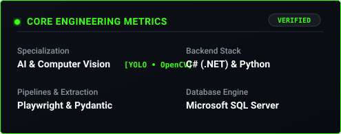
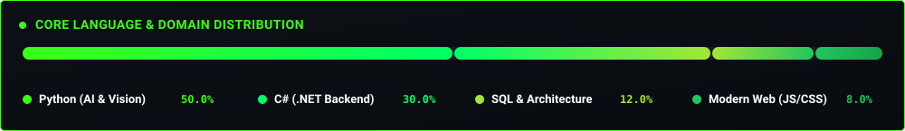

<div align="center">

  <!-- Hero Banner (Completely Non-Clickable) -->
  <picture>
    
  </picture>

  <br/><br/>

  <!-- Dynamic Typewriter Terminal (Completely Non-Clickable) -->
  <picture>
    
  </picture>

  <p align="center">
    <picture></picture>
    <picture></picture>
    <picture></picture>
  </p>

</div>

---

### ⚡ About Me

```yaml
identity: Nick
education: B.S. in Computer Science
specializations:
  - Computer Vision & Object Detection (OpenCV, YOLO)
  - Full-Stack Backend Systems & APIs (C#, .NET, Python)
  - Intelligent Data Extraction & Automation (Pydantic, Playwright)
current_focus: Building production-grade AI pipelines and multi-agent workflows
open_for: Freelance projects, AI engineering contracts, & tech collaborations
```

- 👁️ **Computer Vision & AI**: Developing real-time detection, tracking, and vision systems using **OpenCV**, **YOLO**, and deep learning neural architectures in **PyTorch**.
- ⚙️ **Backend & Enterprise Architecture**: Designing scalable backend solutions and relational data persistence using **C# (.NET)**, **Microsoft SQL Server**, and modern RESTful APIs.
- 🤖 **Intelligent Automation**: Authoring automated scrapers and resilient extraction pipelines leveraging **Playwright**, **BeautifulSoup**, and structured schema validation via **Pydantic**.
- 🌐 **Modern Web Interfaces**: Developing sleek, responsive web client components using **HTML5**, **CSS3**, and **JavaScript**.

---

### 🛠️ Technical Arsenal

<div align="center">

#### 🧠 Artificial Intelligence & Computer Vision
<p>
  <picture></picture>
  <picture></picture>
  <picture></picture>
  <picture></picture>
  <picture></picture>
  <picture></picture>
</p>

#### ⚙️ Backend, Systems & Databases
<p>
  <picture></picture>
  <picture></picture>
  <picture></picture>
  <picture></picture>
  <picture></picture>
</p>

#### 🌐 Frontend & Tooling
<p>
  <picture></picture>
  <picture></picture>
  <picture></picture>
  <picture></picture>
  <picture></picture>
</p>

</div>

---

### 📊 Engineering Focus & Real-Time Metrics

<table align="center" border="0" cellpadding="0" cellspacing="0" style="border-collapse: collapse;">
  <tr align="center">
    <td valign="top" style="padding: 6px;">
      <picture>
        
      </picture>
    </td>
    <td valign="top" style="padding: 6px;">
      <picture>
        
      </picture>
    </td>
  </tr>
  <tr align="center">
    <td colspan="2" valign="top" style="padding: 6px;">
      <picture>
        
      </picture>
    </td>
  </tr>
</table>

---

### 📬 Connect With Me

<div align="center">

```text
Let's build intelligent solutions together.
Whether you need Computer Vision models, backend architectures, or intelligent automation pipelines:
```

<p align="center">
  <picture></picture>
  <picture></picture>
</p>

<p align="center">
  <picture>
    
  </picture>
</p>

</div>
